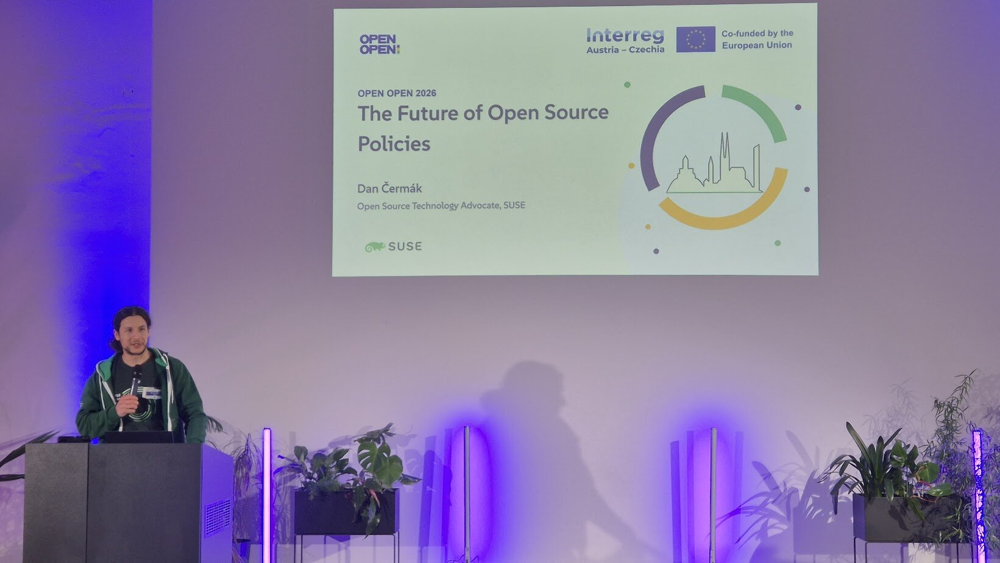
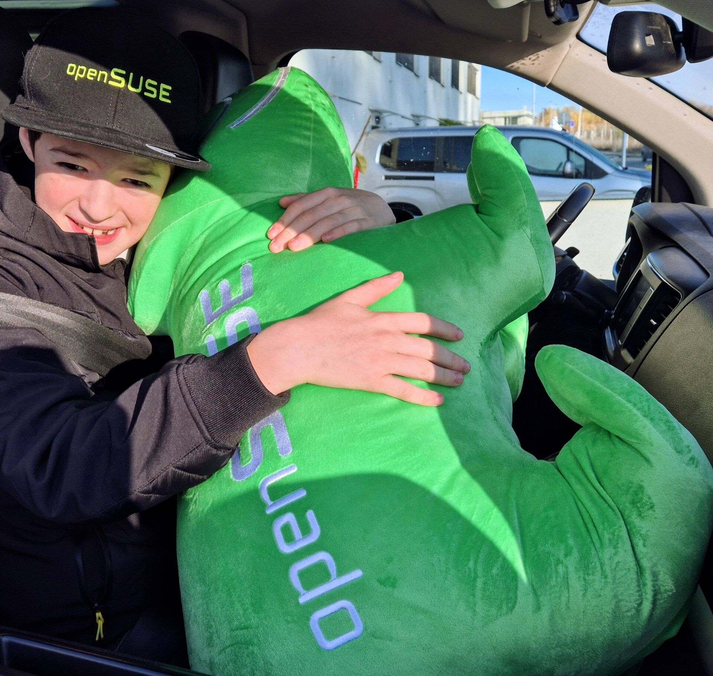
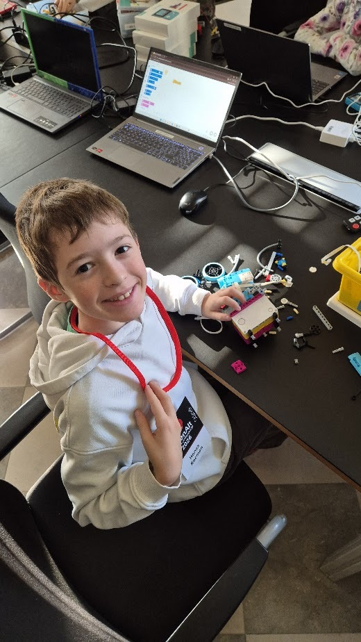
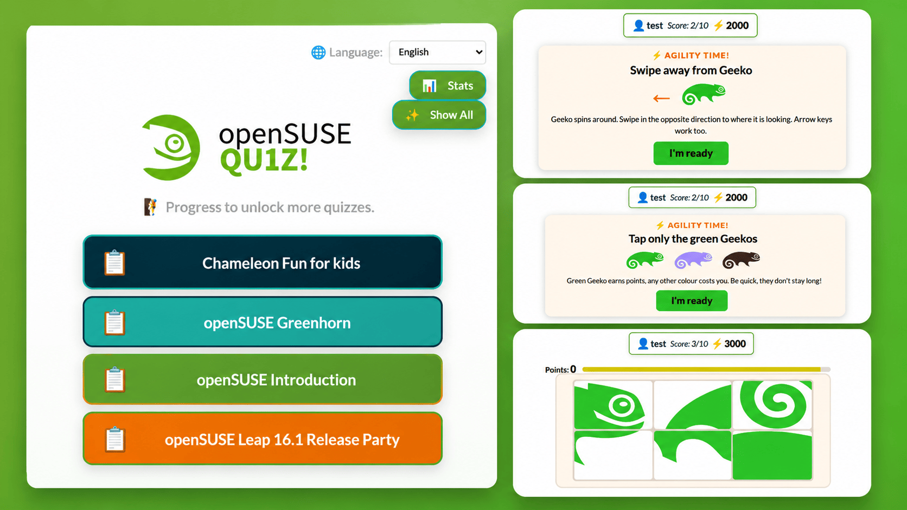
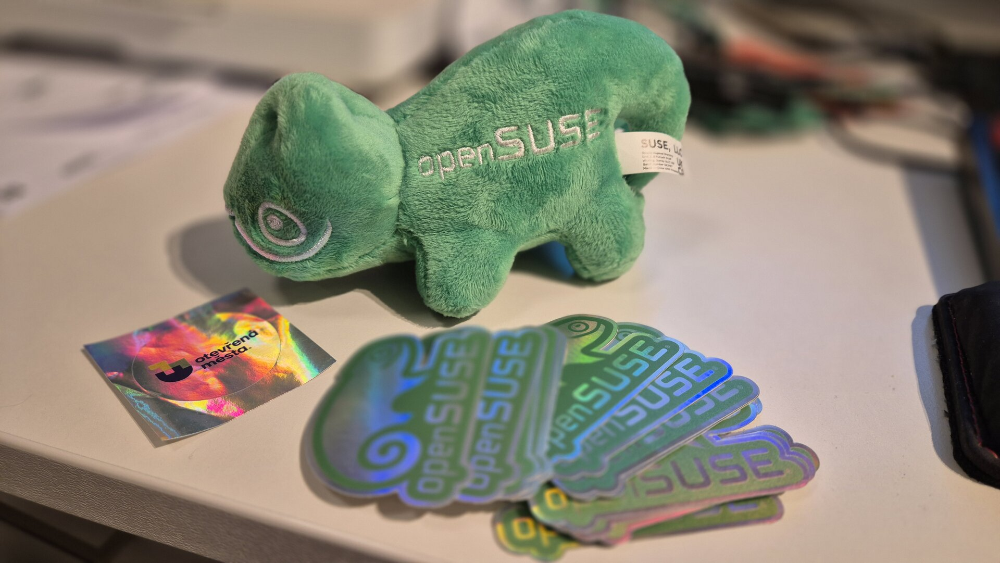
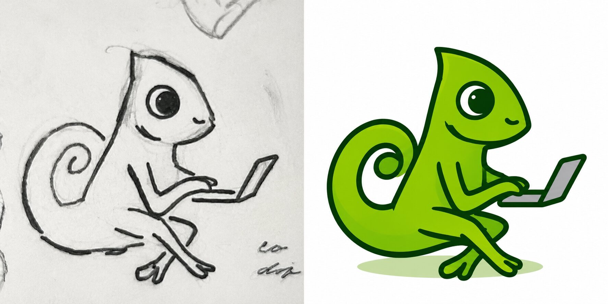
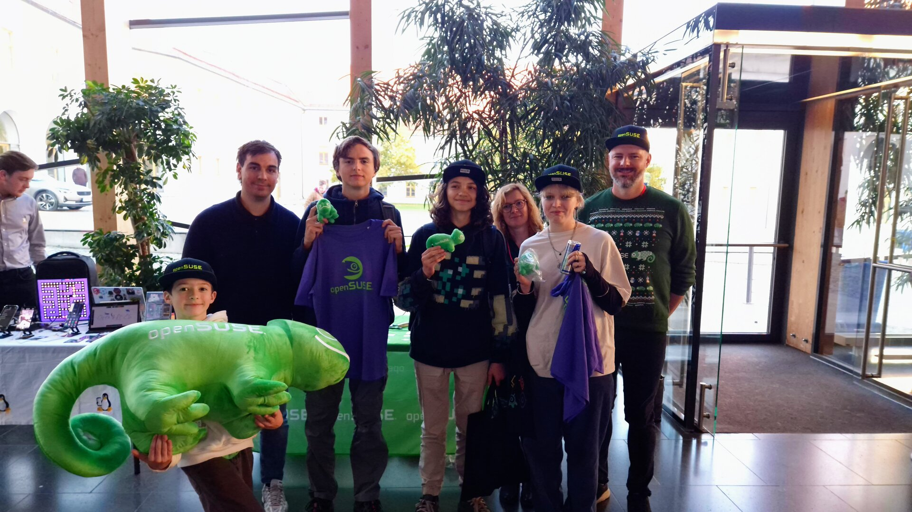

This was a busy weekend in Brno! It started on Friday with Open Open and continued on Saturday with openALT 2026. Two events, new partnership opportunities for openSUSE and SUSE, and this time my kids came along too.

## Open Open 2026, Brno

Friday started at 9am with [Open Open](https://otevrenamesta.cz/), an event organized by Otevřená města (Open Cities), where [Dan Čermák](https://www.linkedin.com/in/dan-%C4%8Derm%C3%A1k-532a1420b/) from SUSE delivered one of the keynotes.

The organizers chose a very interesting spot in the heart of Brno, and the event was really well managed. It was also a nice opportunity to meet some friends from the past.

Open Open was almost flawless. There were many open source vendors, lawyers and people from the corporate open source world. Unfortunately, none of the city or town representatives showed up. That made the track aimed at municipalities a bit awkward, as the intended audience was missing. This definitely needs to be addressed for future events. Maybe each of the participants could help by reaching out to the town hall? This could be a nice ask for help from the organizers towards attendees.

The topics were interesting for us too, though. Generally, plenty of lawyers and open source companies, but missing cities!

### Conversations and potential partnerships

It was nice to meet up again with Lucie Smolka and discuss potential legal cooperation on the openSUSE side, in case the [separate legal entity recently suggested by our Data Protection team](https://code.opensuse.org/board/tickets/issue/122) finally becomes a reality.

Having access to additional legal expertise would be very welcome, so we would not have to rely solely on the already super busy SUSE Legal team.

I also really enjoyed meeting [G. Gabby Demirkiran](https://www.linkedin.com/in/gulcindemirkiran/), who seemed quite excited about the upcoming [SUSE Hack Week 26](https://hackweek.opensuse.org/). Hopefully she will join me and the rest of the SUSE folks in our Brno office from Nov. 30 to Dec. 5.

Another nice encounter was with [Gina Plat](https://www.linkedin.com/in/ginaplat/) from [OpenProject](https://www.openproject.org/). We talked about European alternatives to Jira and potential future collaboration with SUSE. It was a really interesting conversation, especially given the growing interest in European open source solutions.

I was also happy to see [Jaroslav Řezník](https://www.linkedin.com/in/jaroslav-reznik-5413b58/) from Red Hat and [Roman Blanco](https://www.linkedin.com/in/roman-blanco/) advertising the upcoming openALT 2026, which was starting the very next day in Brno.

At the end of their talk, I simply had to stand up and endorse their focus on kids, especially the decision to bring [Robotárna](https://helceletka.cz/robotarna/) as a side track for the entire weekend. More on that later!

I also quite enjoyed the panel discussion at the end with Gina from OpenProject, [Nicholas Gates](https://www.linkedin.com/in/nckgts) from Open Forum Europe, [Jennifer Tridgell](https://www.linkedin.com/in/jennifer-tridgell-%E7%A7%8B%E7%8F%8D%E9%9C%93-2a619366/) from University of Cambridge and [Jan Volmut](https://www.linkedin.com/in/jan-volmut/) from Open Cities.

There was also a quite nice afterparty. I was not among the first to leave, but still left early enough to catch a bus home and see my kids. I think I was home around 8pm.

## [openALT 2026](https://www.openalt.cz/), Brno

Saturday morning started with packing the car, including a rather large Geeko plushie and my kids.

I really enjoy taking my kids with me to conferences, much like I enjoyed business trips with my father when I was little. So naturally I wanted to bring them along, especially when I knew there would be a dedicated program where they could learn something new.

Marcela, who was helping with the openSUSE booth, had the same idea and brought her kids and husband too. So we ended up with quite a family crew at openALT this year.

### Getting the next generation involved

As mentioned earlier, this year's openALT teamed up with Robotárna to provide activities for kids. In previous years, the kids' activities were handled by Miroslav Suchý, so it was nice to see the effort continuing and growing.

Many conferences offer retro gaming or Linux gaming, and while there is nothing wrong with that, I have to say it was really nice to see kids doing something productive and interesting.

We had a similar experience at LinuxDays a year ago, where the kids could try soldering. It is amazing how much they can learn when somebody gives them the right tools and a bit of guidance.

I asked the Robotárna folks whether they could bring their activities to next year's [openSUSE Conference 2027](https://events.opensuse.org/) in Prague.

They explained that they normally organize events only in the South Moravian region, but they are available to be hired for events elsewhere. So perhaps we can make something happen!

On the same topic, I had a discussion with Pavel Šimerda and his daughter about organizing some programming classes for youngsters.

Pavel Tišnovský also tentatively agreed to prepare something coding related, preferably for kids aged 15 and above.

Awesome! It seems like we will have some fun after all!

This topic has become increasingly important to me, especially after seeing the attendance at openSUSE Conference 2026.

Looking around the usual conference hall, there seems to be more and more gray hair, myself included, but not nearly enough new faces.

We need to make open source attractive to the younger generation. And I think giving kids an opportunity to create something, learn programming or simply play with technology is a great way to start.

I am really looking forward to seeing what we can prepare for the junior track at openSUSE Conference 2027.

### The openSUSE booth at openALT 2026

The event itself was really nice. I did not attend many talks, as we were mostly busy at the booth.

For me, the main reason to attend conferences is networking. Meeting people, finding new contributors and trying to build new partnerships.

At our booth, we were mostly luring people to the upcoming openSUSE Leap 16.1 Release Party in Prague and educating them about openSUSE through our [openSUSE Quiz](https://github.com/openSUSE/quiz).

We had also added a dedicated quiz for the [Leap 16.1 release](/2026/11/03/leap-unites-traditional-and-immutable/), so visitors could test their knowledge of the latest release.

### New minigames in the openSUSE Quiz

We were also showcasing our new minigames in the quiz.

These were inspired by lessons learned at the recent openSUSE.Asia Summit in Indonesia, where many of the quizzes included an agility aspect.

Instead of answering only technical questions, participants had to tap on a moving green chameleon, swipe in the direction a chameleon was rotating, solve puzzles and perform similar little challenges.

As it turns out, the most knowledgeable open source folks are not necessarily equally good at agility games. Myself included! :-)))

I think this makes the quiz more balanced and entertaining, especially for visitors who might not yet know that much about openSUSE.

It was great to see people having fun with the quiz, and even better to see some of them learning something new along the way.

### Supporting openALT and the Czech open source community

I also had a brief conversation with Roman Blanco from the openALT organizing team.

It was really heartwarming to hear him asking what openALT could do better for SUSE next year.

I really like the idea of being seen as a trusted partner who helps keep the local Czech open source engine running, while also putting some spotlight on both openSUSE and SUSE, which actually pays the bills.

Hopefully, we can do something similar at local conferences in other countries too.

I think we will certainly be looking into increasing our sponsorship of openALT next year, especially since Red Hat was no longer among the sponsors this year, and there was no Red Hat or Fedora booth either. That is a serious budget cut for an event like openALT.

Sometimes all it takes is to stand up and be willing to help. I do this because I enjoy it and because I believe local communities like this one matter. If you would like to see openSUSE at an event near you, consider this your invitation to do the same!

The organizers are also trying to expand the openALT brand beyond Brno, including other Czech cities such as České Budějovice.

It would be great to see these community events grow, and I would love for SUSE and openSUSE to remain part of that story.

### Turning openSUSE users into contributors

One of the nicest highlights of our openALT presence was meeting our existing users and hopefully turning some of them into future contributors.

Let me explain. :-)

Even if visitors did not make it into the top scores of our quiz, we wanted to recognize people who were already using openSUSE.

If somebody could show us they were an openSUSE user, they left with one of our beautiful holographic stickers and a small Geeko plushie.

It was a small gesture, but a really nice way to thank people for using openSUSE and to start conversations about how they could get more involved.

Which reminds me that we will have to restock both our large and small Geeko plushies soon. We will probably be ordering more swag for openSUSE Conference 2027 in the upcoming months anyway.

Another highlight was meeting a talented artist named Michaela, who won the best contribution award during openALT and went home with one of our large Geeko plushies!

We figured out that she lives near our Prague office, which naturally turned into an invitation to the Leap 16.1 Release Party.

And she actually came, together with her friends! How cool is that? :-)

I think this was the first openALT where we did not have a talk, but we certainly made up for it with plenty of interactions with the public.

And that is exactly what makes these events worthwhile for me.

## Looking ahead to openSUSE Conference 2027

Perhaps the biggest takeaway from the weekend is that community events are not just about talks and presentations.

They are about meeting people, building relationships and finding opportunities to work together.

We came home with new contacts, potential partnerships, ideas for the junior track at openSUSE Conference 2027 and, most importantly, kids who had a great time and want to come back.

Here is my little list of partnership leads I want to follow up on:

- **Legal expertise** with Lucie Smolka, should openSUSE get its own legal entity.
- **Robotárna** for a junior track at openSUSE Conference 2027 in Prague.
- **Pavel Šimerda and Pavel Tišnovský** for programming classes for kids and teenagers.
- **openALT** and a bigger SUSE sponsorship next year, including openALT events outside of Brno.

Marcela's kids also agreed to help with the junior track at next year's conference. What a nice way to make new partnerships! :-D

The [openSUSE Conference 2027](https://events.opensuse.org/) will take place in Prague from June 11 to 13, with a pre-party on Friday at Vila Štvanice and the main conference over the weekend.

We are planning a dedicated junior track and would love to get more young people involved in open source.

If you have ideas for workshops, programming sessions, electronics, robotics or anything else that could be interesting for kids and teenagers, please reach out!

## Thank you

Many thanks to the organizers of Open Open and openALT 2026 for putting together two great events in Brno.

Special thanks to Roman Blanco and the whole openALT team for their continued work on the Czech open source community, and to Robotárna for making the weekend interesting for our youngest visitors.

Many thanks also to Marcela and her family for helping with the booth, to everybody who stopped by for a chat, and to all our quiz participants.

And of course, thanks to my kids for joining me on yet another open source adventure.

I hope to see many of you again at the [openSUSE Conference 2027](https://events.opensuse.org/) in Prague!
