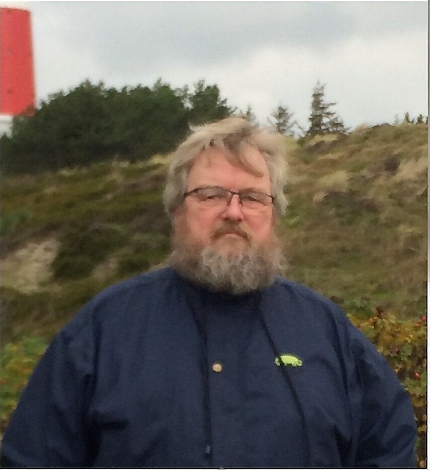
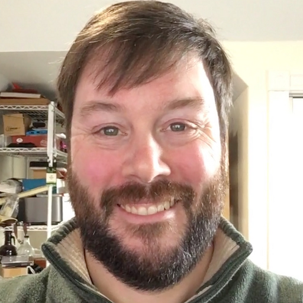
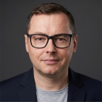
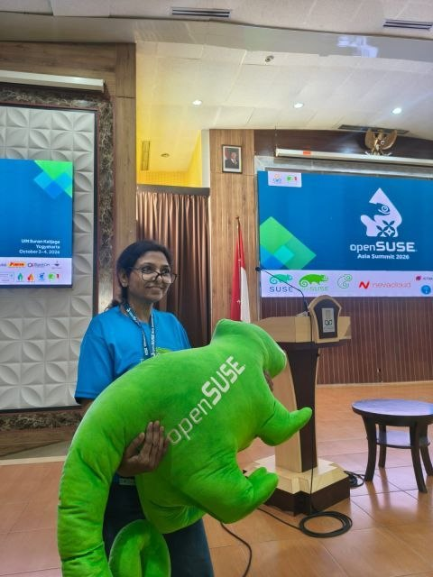

Voting for the **openSUSE Board Election 2026** is now open! Five candidates are running for three available seats on the openSUSE Board, and eligible members have until **November 26, 2026, at 23:59 UTC** to cast their votes.

Only **active [openSUSE Project members](https://en.opensuse.org/openSUSE:Members) with a valid email address registered in the membership database** are eligible to vote. Eligible members should have received an email from election-officials@opensuse.org with the subject "openSUSE Board Election 2026", containing their voting credentials.

## Meet the Candidates

Five members of our community have stepped forward to stand for election. Each brings different experiences and perspectives to the openSUSE Project.

The candidates are listed alphabetically below, along with links to their election platforms or profiles.

### Geetansh Goyal

Geetansh is a computer science student from Bengaluru, India, who joined openSUSE through Google Summer of Code 2026, contributing to Uyuni. He is also leading the bid to bring openSUSE.Asia Summit 2027 to Bengaluru.

In his candidacy announcement, Geetansh expressed his readiness to take on the two-year commitment of serving on the Board and welcomed questions from the community.

[Read Geetansh's election platform](https://en.opensuse.org/openSUSE:Board_election_2026_platform_geetxnshgoyal).

### Ihno Krumreich

Ihno is a current openSUSE Board member who would like to continue serving the project. He previously spent 23 years working at SUSE, initially as a developer working on non-x86 architectures, particularly s390 and s390x, and later as a project manager for SLES on those architectures.

Now retired, Ihno brings technical and project management experience, as well as experience serving on the Board.

[Read Ihno's profile](https://en.opensuse.org/User:Bigiron).

### Jeff Mahoney

Jeff is an experienced open-source contributor and long-time member of the openSUSE community. He has served on the openSUSE Board and currently holds the position of Board Chair.

Jeff is standing for election as a regular Board member, bringing his experience in open-source engineering, leadership, and community governance.

[Read Jeff's profile](https://en.opensuse.org/User:Jeff_mahoney).

### Martin Pluskal

Martin has been an openSUSE member since 2014 and has maintained packages for more than a decade, currently looking after several hundred packages. He has also previously served on the Election Committee and as a Membership Official.

Rather than presenting a long list of promises, Martin emphasizes his willingness to dedicate time to the project and help keep openSUSE a great place to contribute.

Martin currently works for SUSE in maintenance QA.

[Read Martin's election platform](https://en.opensuse.org/openSUSE:Board_election_2026_platform_pluskalm).

### Shobha Tyagi

Shobha has been active in the FOSS community since 2012 and has served on the openSUSE.Asia Committee since 2018. She helped organize openSUSE.Asia Summits in India in 2021 and 2025 and has experience connecting open-source communities with academia.

Her priorities include strengthening regional communities, encouraging participation from new contributors and underrepresented groups, supporting mentoring, and improving collaboration between academia, industry, and open-source communities.

[Read Shobha's election platform](https://en.opensuse.org/Wiki/Board_Election_2026_-_Shobha_Tyagi) and [user profile](https://en.opensuse.org/Wiki/User:ShobhaTyagi).

## Get to Know Your Candidates

We would like to thank all five candidates for stepping forward and being willing to dedicate their time to the openSUSE Project!

Before casting your vote, we encourage everyone to read the candidates' platforms and profiles, ask questions, and discuss their ideas on the [openSUSE Project mailing list](https://lists.opensuse.org/archives/list/project@lists.opensuse.org/).

**What would you like to see the openSUSE Board focus on over the next two years?**

The Board represents the community, helps resolve conflicts, handles matters such as trademarks and legal questions, and provides guidance when needed. It does not directly manage distribution releases or the project's technical infrastructure.

With that in mind, there are several interesting topics worth discussing with the candidates.

For example, the project has been discussing [AI guidelines](https://lists.opensuse.org/archives/list/project@lists.opensuse.org/thread/PEEBFVKYATGZZCQBSI7QXMW7GMR2XCEW/) and **how AI-generated contributions and content should be handled across openSUSE**. What role should the Board play in helping the community establish common expectations?

Another important topic is the ongoing [governance proposal](https://lists.opensuse.org/archives/list/project@lists.opensuse.org/thread/YKI5QVMT66WMZLOPTCQOEQZPTEWPDIBV/), which could introduce changes to the way the project is organized, including a dedicated technical decision-making body.

A **separate community vote on the governance proposal** is planned shortly after the conclusion of the Board election.

This makes governance a particularly timely topic for discussion. How do candidates see the relationship between the Board, technical contributors, and a potential new governance structure? How can we make decision-making more effective without unnecessarily increasing the workload of already busy volunteers?

openSUSE Heroes are [introducing SUSEID](https://lists.opensuse.org/archives/list/project@lists.opensuse.org/thread/Z5MXIW2EBPTVC3BNOKTULYVX3DXKBQLK/), **a new identity management system**, which opens new possibilities with things like membership.

These are just examples. The project has many hot topics right now, and the election is a great opportunity to hear where each candidate stands. We encourage members not to wait: **ask the candidates questions** on the [project mailing list](https://lists.opensuse.org/archives/list/project@lists.opensuse.org/). Questions addressed to all candidates make it easy for everyone to compare their answers and give candidates a chance to explain their views before voting closes.

When asking questions, please keep the Board's role in mind. Questions about packages, release schedules, or technical direction belong with the release teams and maintainers. Questions about the AI guidelines, the governance proposal and the idea of an independent legal entity for openSUSE, or the membership process are a great fit.

Our [previous Board interview](https://news.opensuse.org/2026/02/12/board-interview-participation-gov-community/) may also provide useful background on what serving on the Board involves.

## Cast Your Vote!

Voting in the openSUSE Board Election 2026 is open to **active [openSUSE Project members](https://en.opensuse.org/openSUSE:Members) with a valid email address registered in the membership database**.

Eligible members may select **up to three candidates** using the [openSUSE election system](https://elections.opensuse.org/helios/e/opensuse-board-2026/vote).

If you are an eligible member but have not received your voting credentials, please check your spam folder and contact the [Election Committee](mailto:election-officials@opensuse.org) if the email is still missing.

**Voting closes on Thursday, November 26, 2026, at 23:59 UTC.**

The voting deadline was extended by four days to compensate for the delayed start of the election.

Election results are expected to be announced on **Friday, November 27**, the day after voting closes, and no later than December 1, 2026.

For the complete election schedule, candidate information, and election rules, visit the [openSUSE Board Election wiki](https://en.opensuse.org/openSUSE:Board_election).

Please take the opportunity to get to know the candidates, ask questions, and make your voice heard.

**Have a lot of fun, and don't forget to vote!**
