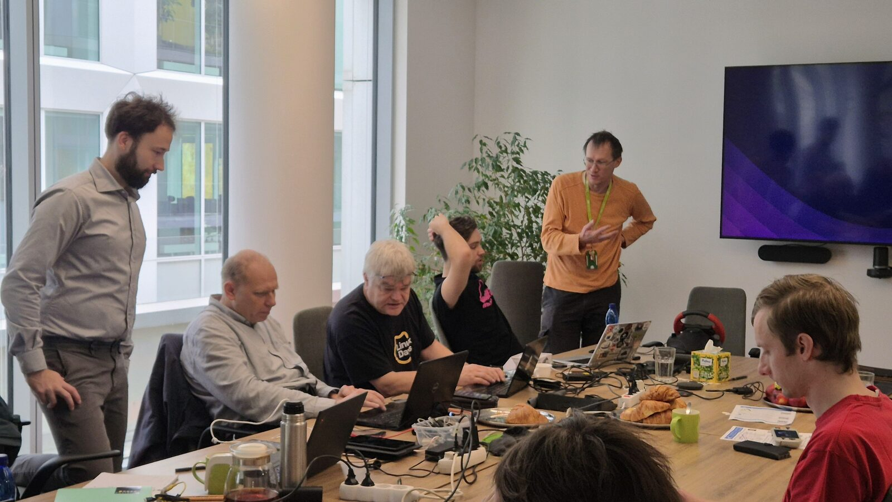
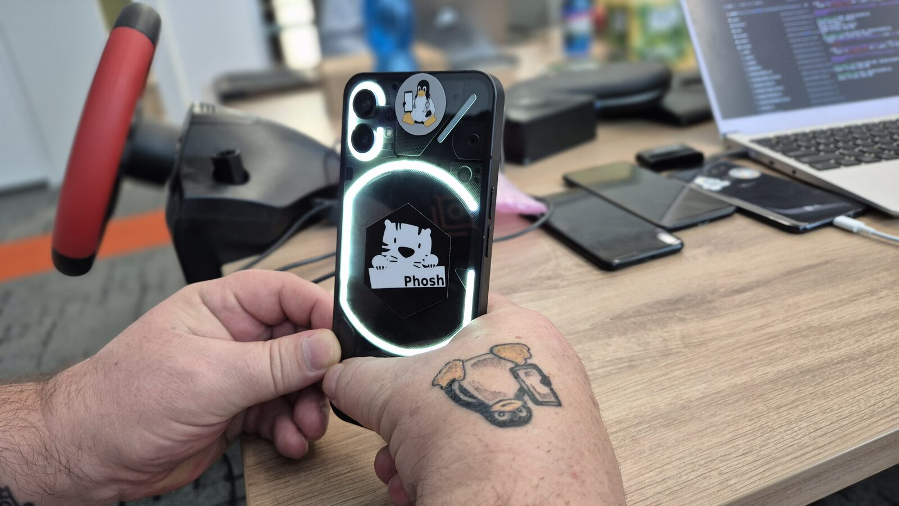
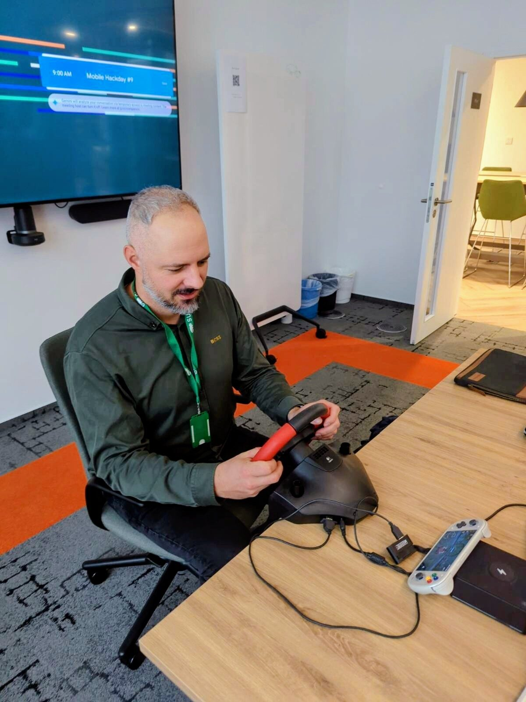
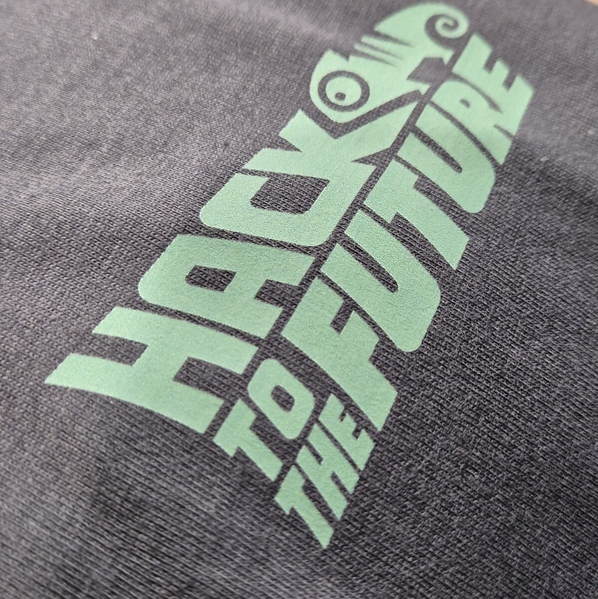

Last Friday, November 20th, we hosted **Mobile Linux Hackday #9** in the SUSE office in Prague. A day full of Linux phones, kernel hacking, good coffee and, as usual, plenty of hallway conversations. I also came home with new leads for the junior track at openSUSE Conference 2027, a potential new SUSE partner, and a bag full of Hack Week T-shirts.

## Mobile Linux Hackday #9, Prague

The day started at 10am in our Karlín office. After the record turnout at [Mobile Linux Hackday #8](/2026/09/01/mobile-hackday-8/) in August, it was really nice to see both familiar faces and newcomers coming back. At the peak, we were around 15 people.

This was also the first time we used a proper [registration form on tuxies.cz](https://tuxies.cz/registrace). Big thanks to the tuxies.cz folks for setting it up! It makes planning, from the number of chairs to the amount of coffee, so much easier. And, as usual, some people still showed up without registering. :-))))

That is perfectly fine, though. The door is always open, and we still had enough chairs this time!

I was organizing the event from the SUSE side, but a hackday like this is never a one-person show.

Many thanks go to David Heidelberg, Petr Hodina and Peter Hošek from [tuxies.cz](https://tuxies.cz) and the University of South Bohemia in České Budějovice. They helped with the program, brought hardware and knowledge, and kept the momentum going for the whole day.

It is great to see the collaboration between SUSE, the Czech mobile Linux community and academia growing with every edition.

### What we hacked on

As always, no prior experience was needed. Just curiosity and a willingness to experiment. Developers and non-developers were equally welcome.

The discussions ranged from the current state of Linux phones and open source project management to NixOS and JTAG debugging. People could bring their own phones to get Linux running on them, or flash one of the older devices and take it home. Some worked on Czech support for the Stevia on-screen keyboard, others tested OpenVlak, an open alternative to the ČD Vlak train app, and the rest of the time was open for hacking on the kernel, applications, services and AI/LLM projects.

### Fancy phones and a Tux tattoo

Some attendees showed up with seriously fancy phones running Linux.

And at least one of them came with a matching Tux tattoo! Now that is what I call commitment to mobile Linux. :-)

### Racing SuperTuxKart with a steering wheel

Of course, it was not all serious work. After all, the openSUSE motto is "Have a lot of fun!", and we take that part very seriously too. :-)

So I could not resist and spent a few minutes racing in SuperTuxKart on a mobile device hooked up to a proper steering wheel controller. Strictly for research purposes, of course! :-)))

## Getting the next generation involved

One of the conversations I was looking forward to the most was with [Pavel Šimerda](https://cz.linkedin.com/in/grumpyprogrammer), whom I invited to the hackday.

If you read my [Open Open and OpenAlt report](/2026/11/13/open-open-openalt-brno/), you already know that Pavel and I have been discussing programming classes for youngsters. This time we talked about collaborating on the **junior track for the upcoming openSUSE Conference 2027**.

Let's be honest with ourselves. As a community, we are simply getting older, at least here in Europe. :-)

Many of us have been around since the early days, and that experience is valuable. But we really want to bring some fresh wind into the project.

A dedicated junior track is one way to give students and young people an approachable entry point into open source, openSUSE and Linux in general.

A mobile Linux hackday, where you can flash an old phone and take it home, is actually a pretty good example of what could attract them.

### Youth education events beyond the conference

The junior track was not the only topic. We also discussed options for hosting youth education events throughout the year, somehow related to open source and IT.

Pavel has spent quite some time exploring this area, including Montessori-inspired approaches to learning. I really like the idea of letting kids explore technology at their own pace, through hands-on activities, rather than just sitting through lectures.

Open source is actually a perfect fit for this. Everything is open, so kids can take things apart, see how they work and build something of their own.

Just like we host the Mobile Linux Hackdays, we could host an event in our Prague office where Pavel presents his work with kids in this area. It could be a nice way to connect parents, teachers and the open source community, and maybe kick off something bigger.

We do not have a concrete plan yet, but I would love to see SUSE and openSUSE help make such events happen. Stay tuned!

## From a high school internship to a SUSE One partnership

I also had a really nice meetup with [Sergey Kuroedov](https://www.linkedin.com/in/sergey-kuroedov/), who used the Mobile Linux Hackday as an opportunity to come and meet me in the SUSE office in Prague.

To explain how we know each other, I have to go back a bit.

It all started at our booth at [InstallFest](https://installfest.cz/) and [LinuxDays](https://www.linuxdays.cz/), where a high school student, Jakub Špaček, approached me. He was looking for a place to do his mandatory two-week internship and asked whether he could do it with us.

Honestly, the timing was a bit challenging. Our Prague office was in the middle of its reconstruction, so finding a proper place for an intern to sit was not exactly trivial. But we made it work, and earlier this year Jakub spent two weeks with our team, Early Adopters. It was a great experience for both sides, and I am glad we could give a young person a look at how open source development works from the inside.

Sergey is Jakub's teacher, and we were already in touch while arranging the internship. Sergey also collaborates with [Pumpedu](https://pumpedu.cz/), so when the hackday came along, he reached out and used the opportunity to meet in person.

Sergey has recently applied for the **SUSE One partner program** and is interested in becoming a certified instructor. I hope I managed to connect him with the right people at SUSE.

Teachers like Sergey are exactly who we need. They bring Linux and openSUSE knowledge into classrooms and, eventually, new people into our community. This ties in nicely with the junior track idea.

### Why showing up matters

This is exactly why I keep saying that our presence at conferences, universities and community events like these hackdays matters.

Just think about it. One conversation at a booth turned into an internship. The internship turned into a connection with a teacher. And the teacher used a community hackday to visit our office and is now looking into a SUSE One partnership.

None of this would have happened without a booth at InstallFest and LinuxDays, or without an open door at our Prague office on a Friday. A lot of networking, internships and partnerships do not come from planned meetings, but from simply being there when somebody wants to talk.

## Hack to the Future: Hack Week T-shirts for Brno

While in Prague, I also picked up a stack of [Hack Week 26](https://hackweek.opensuse.org/) "Hack to the Future" T-shirts for colleagues who will be enjoying Hack Week from our Brno office.

Hack Week starts next week, from November 30 to December 5. If you are still looking for a project, check out our [preview of a handful of Hack Week projects](/2026/11/25/hw-preview/) and join one!

## Takeaways

I came home with quite a few things to follow up on. With tuxies.cz and the University of South Bohemia, we want to keep the Mobile Linux Hackdays going. With Pavel, we will work on the junior track and maybe host an event in our Prague office where he presents his work with kids. And I will keep an eye on how Sergey's SUSE One application and instructor certification go.

All of this leads nicely to the [openSUSE Conference 2027](https://events.opensuse.org/), which will take place in Prague from June 11 to 13. If you have ideas for workshops, programming sessions, mobile Linux hacking or anything else that could be interesting for kids and teenagers, please reach out!

## Thank you

Many thanks to David, Petr and Peter for co-organizing Mobile Linux Hackday #9, to tuxies.cz for the new registration system, to Pavel and Sergey for inspiring conversations about the next generation of contributors, and to everybody who came, hacked, discussed and of course enjoyed the coffee with us.

More photos are available in our [Google Photos album](https://photos.app.goo.gl/sZmhgVUToFJ8HwYG7).

To stay updated on upcoming hackdays, join the **Mobilní Linux Československo** channel on Matrix, follow [Mobile Linux CZ/SK](https://mastodonczech.cz/@mobilni_linux_cs_sk) on Mastodon, or keep an eye on [Root.cz](https://www.root.cz/) and [AbcLinuxu.cz](https://www.abclinuxu.cz/).

See you at Mobile Linux Hackday #10!
